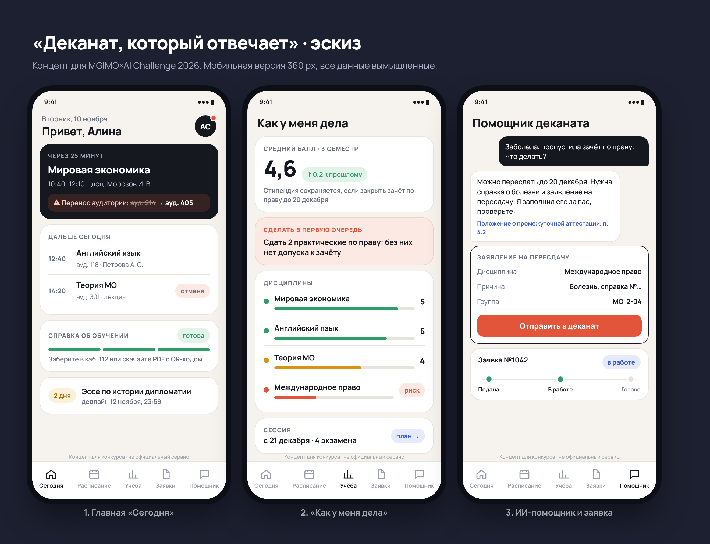
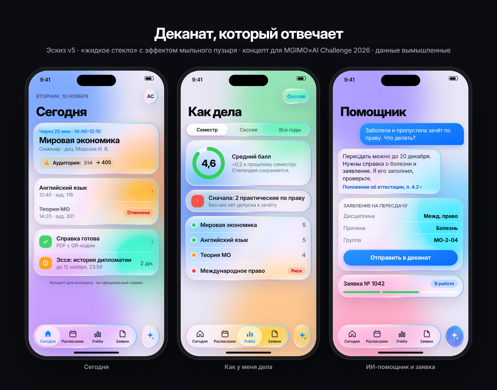
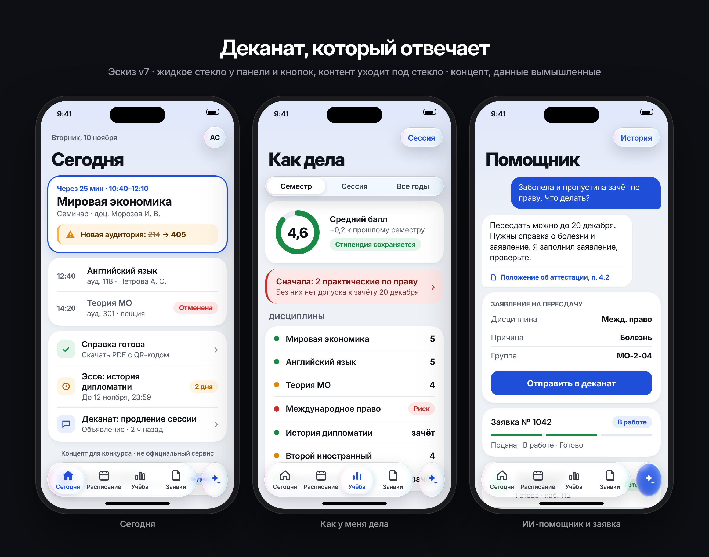
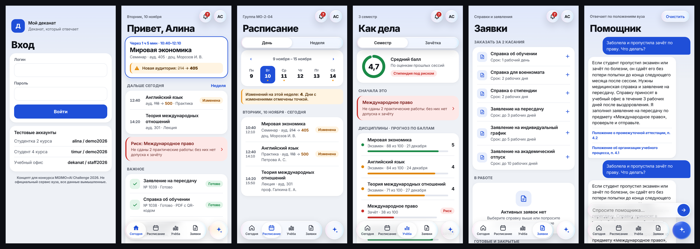
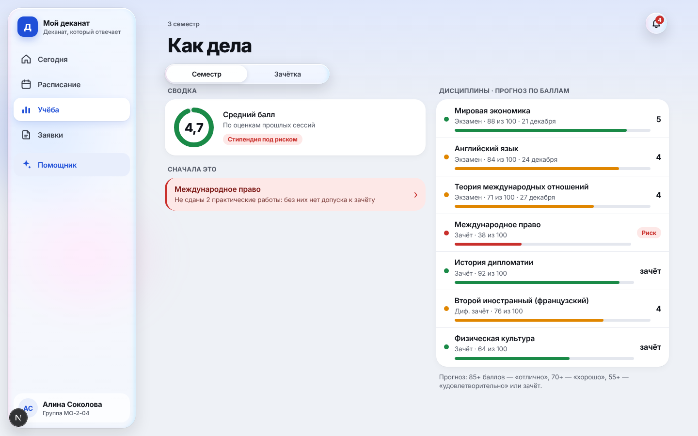
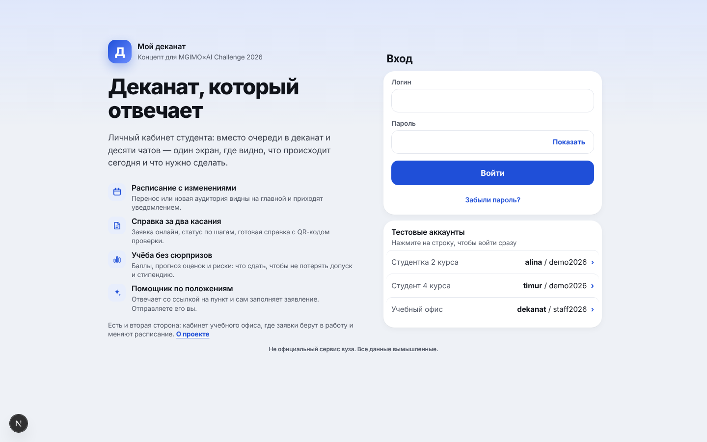
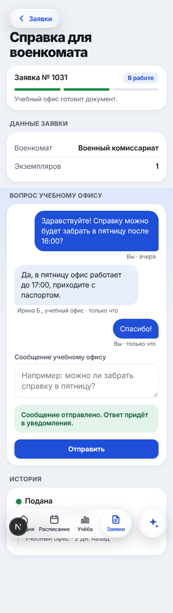
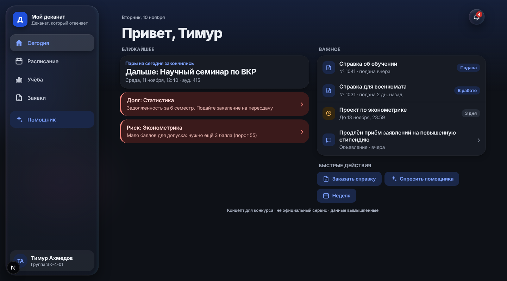

# «Мой деканат»: описание процесса

Номинация «Вайб-кодинг», задание «Цифровой деканат будущего», MGIMO×AI Challenge 2026.
Прототип: https://84.201.147.107.sslip.io · тестовые аккаунты: `alina` / `demo2026`, `timur` / `demo2026`, учебный офис `dekanat` / `staff2026`.
Это концепт для конкурса, не официальный сервис вуза. Все люди, оценки, расписание и положения вымышленные.

## 1. Какую проблему решаем и почему эти разделы

Студент узнаёт о переносе пары из чата группы, о долге перед сессией, а за справкой идёт в очередь. Информация есть, но разбросана, и никто не говорит, что делать прямо сейчас. Идея: **«Деканат, который отвечает»**. Всё сходится на одном экране «Сегодня», а на вопрос отвечают сразу: помощник по положениям вуза или сотрудник в чате заявки.

| Раздел | Какую задачу закрывает |
|---|---|
| Сегодня | Куда идти сейчас, что изменилось, что горит: ближайшая пара, перенос, долг, риск, сроки, статус заявок |
| Расписание | День и неделя, переносы и отмены видны сразу |
| Учёба | Баллы, прогноз оценки, причина риска для стипендии и что с этим делать, зачётка, страница предмета со сроками и контактом преподавателя |
| Заявки | 7 видов справок и заявлений, статус по шагам, справка с QR-кодом и проверкой подлинности без входа, вопрос учебному офису прямо в заявке |
| Уведомления | Объявления, изменения расписания, статусы заявок, сроки |
| Помощник | Отвечает по положениям со ссылкой на пункт, знает данные только вошедшего студента, заполняет черновик заявления |
| Кабинет учебного офиса | Вторая сторона: очередь заявок, смена статуса, ответы студентам, перенос пар, объявления |

Сквозной сценарий для показа: сотрудник переносит пару → у студента уведомление и обновлённая главная → студент спрашивает помощника про пересдачу → помощник заполняет заявление → студент отправляет → сотрудник берёт в работу и отвечает на вопрос в чате заявки → статус «Готово».

Опрос однокурсников не проводили: разделы выбраны по ядру брифа и по собственному опыту учёбы.

## 2. ИИ-инструменты, среда и сервисы

| Инструмент | Зачем |
|---|---|
| Claude Code в облачной сессии (проект Claude с координатором и отдельными тредами под задачи) | Основной исполнитель: разбор брифа, эскизы, код, тесты, выкладка, заметки |
| Субагенты Claude | Параллельная работа: отдельный агент дописал тесты помощника, отдельный сделал тёмную тему, агент `jury-auditor` оценил сайт как жюри и попробовал открыть чужие данные |
| Скил `mgimo-brief-breakdown` | Разбор брифа по 4 критериям жюри |
| Скилы `ui-ux-pro-max` и `site-design` | Правила дизайна: контраст, «стекло только у навигации», запасной вид без прозрачности |
| Playwright (Chromium) | Скриншоты эскизов и готовых экранов на 360, 800, 1100 и 1440 px, сценарные проверки, попытки подмены адреса |
| GitHub + GitHub Actions | Репозиторий, сборка Docker-образа при каждой отправке кода |
| Yandex Cloud (виртуальная машина), Docker, Caddy, watchtower | Хостинг в России, HTTPS, автообновление сайта после сборки |
| Obsidian (репозиторий как хранилище заметок) | Все решения, промпты и ошибки записаны в `.md` и доступны жюри |
| Разбор интерфейса в Claude (артефакт «Разбор „Мой деканат“») | Внешний взгляд: 27 замечаний с оценкой 7 из 10, по ним сделан круг правок |

IDE не использовалась: код писал и запускал Claude Code в облачной среде, человек ставил задачи и проверял результат на живом сайте.

## 3. Файлы для ИИ-агентов и постановка задач

- `CLAUDE.md` в корне: правила для любого агента (язык, что читать перед работой, что не выдумывать требования, записывать каждое решение заметкой и отправлять в GitHub).
- `briefs/` и `notes/vaib-koding-trebovaniya.md`: бриф и разбор требований, от которых агент не отступает.
- `notes/vaib-koding-ideya-i-plan.md`: идея, сквозной сценарий, план по дням.
- `.claude/agents/jury-auditor.md`: агент-проверяющий с критериями жюри.
- `.claude/skills/`: скилы дизайна.
- `02-vibe-coding/prompt-log.md`: журнал промптов и ошибок ИИ, дописывается после каждого этапа.

Пример постановки задачи субагенту (тёмная тема, сокращённо): «Добавь тёмную тему по `prefers-color-scheme`. Светлая тема не должна измениться ни на пиксель. Менять можно только такие-то файлы. Контраст текста не ниже 4,5:1, посчитай для основных пар. Справка с QR-кодом остаётся белым листом. Сними скриншоты каждого экрана на 360 и 1440 px, посмотри каждый и исправь нечитаемое. В отчёте: что изменено, контрасты, что осталось неидеальным». Агент вернул таблицу контрастов, 36 скриншотов и список слабых мест; основной ИИ перепроверил результат своими скриншотами.

## 4. Этапы, ключевые промпты и скриншоты

Промпты Роберта приведены дословно.

### 09.11. Разбор брифа, хостинг, идея
- «так стой разбери только бриф и требования сейчас» → разбор ядра, требований к сдаче и критериев.
- «какие варианты есть где можно бесплатно хостить?» → сравнение площадок с учётом доступности из России, выбран Yandex Cloud.
- «давай» → идея «Деканат, который отвечает», сценарий, план.

### 09.11. Эскизы: семь версий за день
| Версия | Промпт | Что вышло |
|---|---|---|
| v1 | «сделай картинку как это будет выглядеть» | Три экрана в HTML, снимок Playwright |
| v2 | «сделай в стиле apple» | Крупные заголовки, сгруппированные списки |
| v3 | «как новое оформление на айфонах жидкое стекло» | Стеклянные карточки на цветном фоне |
| v4 | (скил UI UX Pro Max) | Скил указал на ошибку: стекло должно быть только у навигации |
| v5 | «зеркальный эффект мыльно пузырный» | Радужные края и блики. Красиво, но текст читается хуже |
| v6 | Разбор Роберта из 7 пунктов: «стиль мешает содержанию…» | Цвет только для смысла, один фон, контраст выше 6:1 |
| v7 | «ты убрал эффект жидкого стекла» | Контент уходит под стеклянную панель, стекло видно при прокрутке |

Первый эскиз:

Неудачный вариант (v5): эффект спорит с содержанием.

Утверждённый стиль (v7):

### 10.11. Сборка сайта
- «Вроде нормалды» (стиль утверждён) → собран сайт: вход, пять разделов студента, кабинет офиса, помощник, тесты.

### 10.11. Выкладка
Роберт создавал виртуальную машину по шагам со скриншотами консоли, ИИ разбирал ошибки по логам. Сайт заработал с третьей попытки (см. раздел 5).

### 10.11. Версия для компьютера и анимации
- «Сделай мне имбовый моушен дизайн и исправь дизайн сайта для компов а то по бокам слишком пусто» → от 1024 px боковое меню и две колонки; появление блоков по очереди, переезжающий индикатор раздела, заполнение кольца и полос. При настройке «уменьшить движение» анимации отключаются.

### 10.11. Правки по разбору интерфейса
- Роберт прислал разбор (7 из 10, 27 замечаний), затем «можешь взять субагентов для ускорение работы» → помощник перестал выдумывать и обсуждать чужие данные, страница входа объясняет проект, вход одним касанием, заявление на повышенную стипендию, ночной сброс демо-данных. Полный список: `notes/vaib-koding-razbor-interfeysa.md`.

### 10.11. Чат по заявке и тёмная тема
- «а что не все ?» (про загрузку справки, от которой ИИ дважды отказался) → ИИ сделал её в ограниченном виде: PDF, JPG и PNG до 2 МБ, тип проверяется по первым байтам файла, а не по расширению; файл отдаётся только на скачивание и только владельцу заявки или офису; общий объём ограничен, ночью файлы стираются вместе с демо-данными.
- «что ты хочешь сделать ?» → ИИ предложил чат с офисом и тёмную тему, от загрузки файлов и push отказался и объяснил почему. «делай» → сделано в тот же вечер.

### 10.11. Проверка «как жюри»
- «найми субагентов для скорости и улучшения работы» → агент-проверяющий поставил 28 из 40, попробовал открыть чужие заявки и написать в чужой чат (не получилось), нашёл три ошибки помощника и устаревающие даты. Исправлено в тот же вечер. Отчёт: `notes/vaib-koding-ocenka-zhyuri-10-11.md`.

## 5. Ошибки ИИ и как их поймали

| Ошибка | Как нашли | Что сделали |
|---|---|---|
| Чужая заявка показывала «не найдено», но сервер отвечал кодом 200 | Автопроверка подмены адреса | Теперь честный 404 |
| Стиль v3–v5 мешал читать | Замечание Роберта, 7 пунктов | Правило «стекло только у навигации, цвет только для смысла» |
| Помощник на вопрос не по теме подставлял первый попавшийся пункт положения | Разбор интерфейса | Порог уверенности, ответ «не нашёл, гадать не буду» |
| Изменения расписания повторялись на каждой неделе | Разбор интерфейса | Изменения только в ближайшие дни |
| Цена сервера: ИИ назвал 800–1000 ₽ в месяц, вышло 1483 ₽ | Роберт увидел цену в консоли | Исправили расчёт, записали в журнал |
| Виртуальная машина поднялась пустой: веб-форма сохранила одну строку настроек | Логи последовательного порта | Создание командой из Cloud Shell |
| Адрес сайта в настройках сервера стёрся (знак доллара в настройках) | Диагностика, которую ИИ дописал в сценарий запуска | Адрес вписывается без переменных |
| На компьютере пункты меню встали по центру, активная кнопка стала белой на белом | Скриншоты Playwright до выкладки | Исправлено до отправки |
| В справке слиплись слова «курсаочной», очередь офиса была пустой, форма входа на телефоне уехала вниз | Скриншоты Playwright | Исправлено до отправки |
| Помощник не знал про долг студента; слово «Сталинградская» принимал за вопрос про Алину | Агент-проверяющий | Исправлено, добавлен тест |
| Помощник верно отвечал только на 56 % разговорных вопросов | Отдельный агент задал 229 вопросов живым языком | Добавлены сленг и ответы по данным студента, тестов стало 28 |
| ИИ написал, что сам проверит живой сайт, а сеть его среды этот адрес не открывает | Сам ИИ при попытке | Сообщение исправлено, живой сайт проверяет Роберт |

## 6. Вход, хранение и защита простыми словами

- **Вход.** Логин и пароль. Пароль в базе не хранится, хранится только его необратимый отпечаток (bcrypt). После входа браузер получает случайный ключ в защищённой cookie, которую не видят скрипты страницы; в базе лежит только отпечаток этого ключа. Вход действует 7 дней. После 5 неверных попыток разрешена одна попытка в минуту.
- **Чужие данные.** Сервер при каждом запросе узнаёт студента по ключу входа и ищет данные только среди его записей. Если подставить в адрес номер чужой заявки или предмета, сервер ответит «не найдено». Это проверено автотестами и отдельным агентом.
- **Помощник.** Получает только данные вошедшего студента. Вопрос про другого человека отклоняет код ещё до поиска и до модели. Заявление помощник не отправляет: он готовит черновик, отправляет студент.
- **Ключи.** Секретов в коде и репозитории нет. Ключ модели (если его подключить) живёт только в настройках сервера.
- **Данные.** Только вымышленные. Демо-данные каждую ночь в 04:00 по Москве возвращаются к исходным, поэтому следы проверок не копятся. Важно для жюри: созданная заявка сохраняется и видна после перезагрузки и повторного входа, но на следующий день демо начнётся с чистого листа.
- **Защита от спама.** Ограничения на число заявок, вопросов помощнику и сообщений в чате заявки.
- **Шрифт и иконки.** Inter (лицензия OFL) раздаётся с нашего сервера, иконки нарисованы вручную. Библиотеки с открытой лицензией MIT.

## 7. Что делалось вручную

- Роберт: выбор идеи и хостинга, все решения по стилю (семь кругов эскизов, разбор из 7 пунктов), регистрация в Yandex Cloud и создание сервера, проверка живого сайта на Mac и телефоне, решение, какие идеи из разбора делать.
- ИИ под проверкой Роберта: код, тексты вымышленных положений, вымышленные данные, тесты, скриншоты, заметки.
- В команде вайб-кодинг ведёт Роберт; второй участник занимается номинацией «ИИ-ролик».

## 8. Что не сделано и почему

- Push-уведомления: на iPhone работают только у сайта, добавленного на главный экран. Уведомления внутри сайта есть.
- Настоящая ИИ-модель в помощнике подключается настройкой сервера; без неё помощник отвечает по правилам и поиску по положениям. На момент первой подачи (11.11) модель не подключена, помощник работает по правилам.
