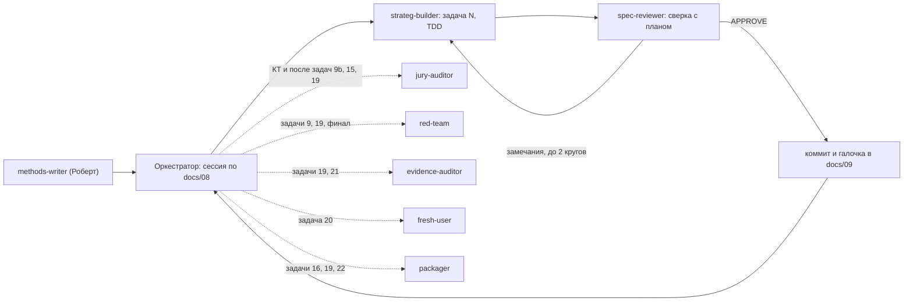

# ИИ-проект: агенты, которые делают работу качественнее

> Здесь два разных вопроса.
> 1. **Агенты сборки.** Помогают нам собрать и проверить проект. Живут в корне репо, в `.claude/agents/`; жюри их не видит.
> 2. **ИИ-роли внутри продукта** `strateg-agent`. Их видит и оценивает жюри.
>
> Для обоих действует правило брифа: «каждый компонент должен оправдывать свою сложность пользой». Поэтому у каждого агента ниже есть строка «без него».
>
> Связанные документы: [мастер-промпт](08-ii-proekt-master-prompt.md) · [план](09-ii-proekt-plan-sborki.md) · [промпт проверки](11-ii-proekt-prompt-proverki.md).

## 1. Команда сборки: 8 агентов (файлы готовы в `.claude/agents/`)

| Агент | Когда вызывать | Что делает | Модель | Без него |
|---|---|---|---|---|
| `strateg-builder` | задачи 1–20, кроме 3, 6, 9b и 16 (их ведёт человек с главной сессией) | реализует ровно одну задачу плана по TDD и коммитит локально | sonnet | контекст главной сессии забивается кодом, правила кода плывут от задачи к задаче |
| `spec-reviewer` | после каждой задачи | сверяет результат с планом, docs/07 и брифом, сам гоняет тесты, ничего не правит | opus | ошибки интерфейсов всплывают только на сквозном прогоне 14.11, когда чинить дорого |
| `jury-auditor` | КТ-A, КТ-B, финал, после задач 9b (только содержание), 15, 19 | оценивает работу как жюри по 4 критериям брифа и сортирует правки по «баллы за час»; подходит для всех трёх номинаций | opus | о слабых местах узнаём от жюри 28.11 |
| `evidence-auditor` | задачи 19 и 21 | вручную сверяет 10 случайных утверждений и ссылок с первоисточником; проверяет факты из ответов чатов для сравнения | opus | нет числа «X из 10 верно» для описания, критерий «проработанность» держится на словах |
| `red-team` | задачи 9, 19, перед финалом | атакует инъекциями в PDF, DOCX, HTML, XLSX и отзывах, пробует подменить правила, ищет утечки ключей и ПДн; работает во временной копии | sonnet | требование брифа «команды из источников не меняют правила» не доказано |
| `fresh-user` | задача 20 и после правок README | как член жюри ставит агента из ZIP, выполняет README буквально, записывает все «угадывания» | sonnet | первый запуск у жюри ломается на мелочи, которую мы не видим: у нас всё уже настроено |
| `methods-writer` | задача 15 (зона Роберта) | пишет 8 карточек методик по единому шаблону — рабочие, а не учебные | sonnet | методики разного качества и формата, агент применяет их непоследовательно |
| `packager` | задачи 16 (v0), 19 (v1), 22 (финал) | готовит чек-лист сдачи, сценарий видео с командами, черновик описания (каждое число со ссылкой), проверяет архив для жюри | sonnet | забытый пункт сдачи или выдуманная цифра в описании |

**Как они работают вместе:**

**Принципы, на которых держится качество:**
1. **Делает один, проверяет другой.** Ревьюер не видел работы исполнителя, получает только план и код и сам запускает тесты.
2. **Проверяют по доказательствам, а не по словам.** Все проверяющие агенты пишут PASS только с выводом команды или ссылкой файл:строка. «НЕ ПРОВЕРЕНО» — это не PASS.
3. **Проверяющие ничего не правят.** Они пишут только свой отчёт, поэтому чинить остаётся исполнителю и не получается «тихо подогнать».
4. **Сильная модель там, где нужно суждение.** Ревью и аудит идут на `opus`, сборка и рутина — на `sonnet`.
5. **Взгляд жюри отдельно от взгляда инженера.** `spec-reviewer` проверяет соответствие плану, `jury-auditor` — соответствие брифу и баллам. Это разные вопросы, и ловят они разные ошибки.

## 2. Как вызывать

- **Где.** Claude Code в корне `chellenge/`. Агенты появятся после `git pull` и перезапуска; список — команда `/agents`.
- **Примеры:**
  - «Используй агента spec-reviewer: проверь задачу 7, коммиты a1b2c3..d4e5f6»;
  - «Используй jury-auditor: ai-project, уровень K»;
  - «Используй red-team: инъекции, проект esim-travel».

  Полные шаблоны поручений — в [docs/08](08-ii-proekt-master-prompt.md), разделы 5.3–5.4.
- **Модель на один запуск.** Её можно поменять в поручении, например «spec-reviewer на sonnet»: для простых задач 1, 5, 12 и 14 этого хватает.
- **Роберту.** Те же файлы в том же репозитории. `jury-auditor` подходит и для вайб-кодинга: «Используй jury-auditor: номинация vibe-coding, работа в <папка или ссылка>, уровень K». Отчёт он положит в `notes/`.

## 3. Стоимость использования

Примерная оценка на весь проект — около 60 запусков:
- `strateg-builder` — около 20;
- `spec-reviewer` — около 22 (с повторными кругами);
- `jury-auditor` — 5;
- `evidence-auditor` — 2;
- `red-team` — 2–3;
- `fresh-user` — 2;
- `methods-writer` — 1–2;
- `packager` — 3.

Если лимит подписки заканчивается, экономить в таком порядке:
1. ревью простых задач перевести на `sonnet`;
2. объединить ревью двух соседних простых задач;
3. `jury-auditor` после задач 9 и 15 пропустить и оставить только КТ и финал.

Аудит на КТ и `evidence-auditor` не сокращать: они дают баллы.

## 4. ИИ-роли внутри продукта (что увидит жюри)

| Роль | Где | Модель | Польза | Чего не делает |
|---|---|---|---|---|
| Главный агент | среда (Claude Code, Cursor, OpenCode) по `AGENTS.md` и playbooks | Claude или модель среды | ведёт 6 шагов, говорит с человеком, пишет варианты и стратегию со ссылками `[C-…]` | не создаёт фактов (У10) |
| Извлекатель | `extract.py` | YandexGPT Lite → Pro | дешёвое извлечение утверждений с дословной цитатой; маршрут выбран по замеру спайка | работает без инструментов, табличных фактов не создаёт |
| Классификатор релевантности (P2) | `extract.py` (relevance) | Lite | на новый вопрос не перегоняет весь источник, отвечает «да» или «нет» по частям | не извлекает |
| Критик | `critic.py` | Pro или модель другого семейства | независимые возражения к вариантам, проверка обещаний (`--promises`) и толкования (`--claims-sample`) | не видит сырых источников |
| Модельный респондент | `respond.py` | Pro | гипотезы и вопросы для настоящих интервью | его ответы не могут быть единственным основанием рекомендации (проверка 9) |
| Наблюдатель UX | субагент `ux-observer` | Claude, только чтение | разбирает скриншоты в изоляции, описывает только видимое, с локатором | не пишет файлов и не ходит в сеть |
| Кодировщик интервью (P2) | `interviews.py` | Lite | матрица «тема × респондент» по кодовой книге | не хранит ПДн |
| Судья (только evals) | `evals/blind.py` | YandexGPT Pro (второй судья — Роберт вслепую) | слепая оценка «агент против чата» | в работе агента не участвует |

Без ключа (У16) роли извлекателя, критика и респондента выполняет модель среды через `--emit-prompt` и `--apply`, с теми же проверками; критик тогда работает в чистом контексте, а статус честно показывает жёлтую строку о независимости.

Детерминированные скрипты — это не LLM, но они держат доверие и в описании называются «проверяющими компонентами»:
- `check.py` — 11 проверок;
- `analyze.py` — ячейки и расчёты;
- `impact.py` — граф связей;
- `export.py` — читаемая стратегия со сносками;
- `lock.py` — целостность правил.

### Что стоит добавить (с оценкой)
1. **`critic.py --claims-sample`** — проверка толкования, уже в плане (У13, задача 11). Закрывает главную оговорку docs/07: скрипт доказывает совпадение цитаты, но не правильность её толкования. Цена — 0,5–1 ч.
2. **Поиск по смыслу** через эмбеддинги AI Studio. Это P2 и только если эмбеддинги есть в OpenAI-совместимом API (проверяется в задаче 3). Пункт «База знаний» станет полным. Цена — около 1 ч.
3. **`interviews.py`** — P2: пункт «Интервью» станет полным. Цена — 1,5 ч.
4. **Расшифровка аудио интервью** (SpeechKit) перед `interviews.py`. Это P3, только если останется время: «аудио» станет частично закрытым.

### Чего не добавлять
- **«Совет» из 6–8 субагентов Claude** (исследователь, маркетолог, аналитик…). Бриф прямо говорит, что число агентов не преимущество. Гарантии в субагентах Claude не переносятся в Cursor и OpenCode, а переносимость — тоже пункт оценки.
- **Субагента-«исследователя» поверх `extract.py`.** Он дублирует скрипт и тянет сырые источники в контекст главного агента: растут риск инъекций и цена.
- **MCP-сервер.** Жюри пришлось бы его настраивать, а сверх CLI он ничего не даёт. В описании честно пишем: «MCP — нет, CLI — да».
